# 长窗事件研究：−60至+60，−60日为基期

两种Y、三个时期、二组／三组分类，分别输出组内估计与共同interaction的组间差，共36套回归、24张图。全部由Stata估计和绘图，Python仅独立校验与组装本说明。主报告和旧图不覆盖。

## 样本与Y

沿用当前短窗threshold的20,408份公告、4,340家公司；好消息surprise>0.10，中性为−0.10至0.10，不含坏消息。分期按财年：2001—2011、2012—2024。非四大合并本土八大和Other。长窗不再要求121日齐全。

价格：$Y_{ik}=\ln(P^{TR}_{ik})$，直接使用供应商“考虑现金红利再投资的收盘价的可比价格”。回归保留所有可观察日，不填价格。由于公司×财年FE吸收公告特定常数，某公告−60日无价格不要求删除整份公告；这里不是将每家公司的价格先除以其−60日价格后再回归。

CAR：$Y_{i,-60}=0$，$Y_{ik}=\sum_{j=-59}^{k}(r^{TR}_{ij}-r_{mj})$。市场收益沿用前一交易日流通市值权重；缺失个股收益记0，仍扣市场收益。此规则是已确认的缺日假设。

在这套FE下，累计全市场收益可写为“实际日期函数−该公告基准日常数”，分别被交易日期和公司×财年FE吸收。因此，在样本与缺日处理相同的前提下，是否扣除这个共同市场累计收益不改变斜率；价格log与CAR的对照还涉及对数变化与日收益算术累计的区别。

价格图纵轴为100倍log价格响应；CAR图为百分点。原始字段中的上港2002财年除权异常未修复或排除。数据字段一致性和数值验证不能保证供应商所有公司行动处理正确。

## 方程与解释

共同FE记为 $FE=\alpha_{i,t}+\delta_k+\lambda_{date}$，分别为公司×财年、相对事件日、实际交易日期固定效应；均按公司×财年聚类，无额外控制。

组内图：每个审计组单独估计 $Y=FE+\sum_{k\ne-60}\theta_{gk}Good\,D_k+\varepsilon$。画的是该组“好消息−中性消息”的相对−60日响应，不能直接解释为该组客户的整体股价涨幅。

共同interaction图：$Y=FE+\sum_g\sum_{k\ne-60}\beta_{gk}A_g Good\,D_k+\varepsilon$。不额外加入 $A_gD_k$，保持原受限式；中性消息各组共享相对事件路径。画二组模型的四大−非四大，及三组模型的四大−Other、本土八大−Other。

事前联合检验为 $H_0:\theta_{g,-59}=\cdots=\theta_{g,-1}=0$，共同模型对应组间系数差联合为0。显著说明相对基期的事前路径存在差异，不能直接证明消息提前泄露或提前定价。

区间变化另用同一模型的lincom计算，并使用两端完整协方差：−60至−1、−1至+5、−1至+60、+5至+60。不能把两端标准误独立相加。

图形统一为实线路径；全部121个事件日均展示逐点95%置信区间area阴影，不抽取日期。阴影不加offset，估计线沿用既有offset；四大为酒红色、本土八大为绿色、Other与非四大为灰色。阴影为逐点区间，不是整条路径的同时置信带。

## 含分红再投资价格log：关键系数与事前检验

|时期|估计对象|−1日：系数（p）|+5日：系数（p）|+60日：系数（p）|事前联合p|
|---|---|---:|---:|---:|---:|
|all|四大组内|2.055（0.0010）|2.496（0.0002）|1.570（0.0802）|0.4931|
|all|非四大组内|1.324（0.0000）|1.856（0.0000）|1.455（0.0005）|0.0575|
|all|本土八大组内|1.042（0.0056）|1.614（0.0001）|1.122（0.0360）|0.2383|
|all|Other组内|1.774（0.0001）|2.246（0.0000）|2.052（0.0021）|0.2948|
|all|四大−非四大|-2.805（0.0000）|-2.534（0.0001）|-3.717（0.0000）|0.0082|
|all|四大−Other|-3.199（0.0000）|-2.736（0.0001）|-3.964（0.0000）|0.0068|
|all|本土八大−Other|-0.642（0.1934）|-0.327（0.5372）|-0.401（0.5795）|0.3969|
|before2012|四大组内|3.446（0.0057）|4.248（0.0019）|3.829（0.0321）|0.0426|
|before2012|非四大组内|2.918（0.0000）|3.670（0.0000）|4.369（0.0000）|0.0223|
|before2012|本土八大组内|3.206（0.0001）|4.163（0.0000）|5.020（0.0000）|0.1957|
|before2012|Other组内|2.815（0.0000）|3.404（0.0000）|3.919（0.0002）|0.0570|
|before2012|四大−非四大|-4.327（0.0001）|-3.557（0.0035）|-4.166（0.0116）|0.0004|
|before2012|四大−Other|-4.410（0.0001）|-3.475（0.0060）|-3.833（0.0278）|0.0048|
|before2012|本土八大−Other|-0.180（0.8286）|0.202（0.8219）|0.774（0.5508）|0.7711|
|after2012|四大组内|1.605（0.0262）|1.964（0.0108）|0.963（0.3506）|0.5387|
|after2012|非四大组内|0.681（0.0483）|1.258（0.0006）|0.510（0.2941）|0.1900|
|after2012|本土八大组内|0.513（0.2234）|1.074（0.0169）|0.326（0.5820）|0.2027|
|after2012|Other组内|0.986（0.1012）|1.589（0.0139）|0.975（0.2513）|0.7640|
|after2012|四大−非四大|-2.123（0.0026）|-2.090（0.0053）|-3.400（0.0009）|0.0698|
|after2012|四大−Other|-2.212（0.0071）|-2.154（0.0142）|-3.593（0.0025）|0.1371|
|after2012|本土八大−Other|-0.131（0.8359）|-0.094（0.8890）|-0.279（0.7547）|0.6962|

### 全样本：含分红再投资价格log

**二组：分别组内回归**

Y为供应商含分红可比价格的log；样本为全样本的好消息与中性消息公告。$Y=FE+\sum_{k\ne-60}\theta_{gk}Good\,D_k+e$，各审计组分别回归；曲线为各组好消息相对中性的响应。 公司×财年、事件日、实际日期FE，公司×财年聚类，无额外控制；系数以−60日为基期，纵轴为100倍系数。

|回归样本|公告|公司|有效日观察|每份公告日数范围|
|---|---:|---:|---:|---:|
|四大组内|2,580|456|309,371|62—121|
|非四大组内|17,828|4,094|2,123,947|40—121|

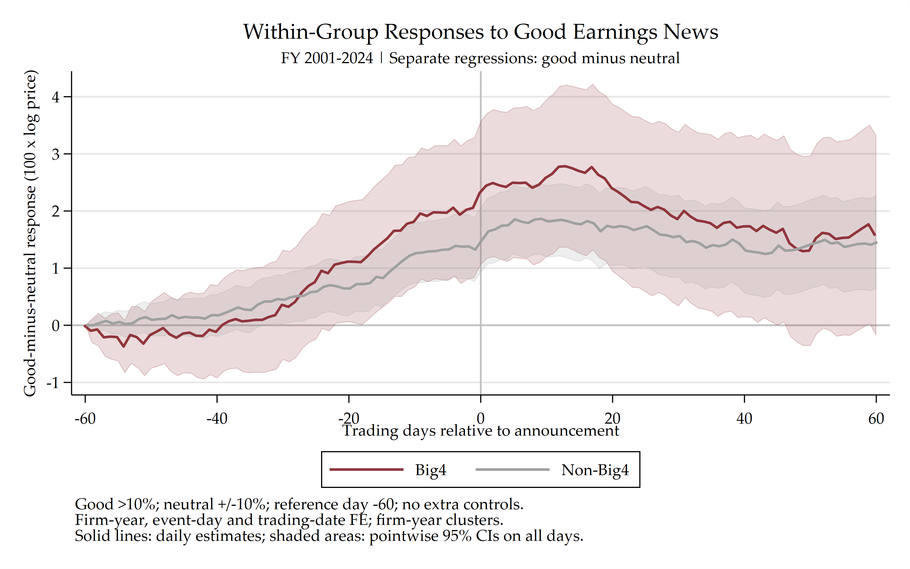

**三组：分别组内回归**

Y为供应商含分红可比价格的log；样本为全样本的好消息与中性消息公告。$Y=FE+\sum_{k\ne-60}\theta_{gk}Good\,D_k+e$，各审计组分别回归；曲线为各组好消息相对中性的响应。 公司×财年、事件日、实际日期FE，公司×财年聚类，无额外控制；系数以−60日为基期，纵轴为100倍系数。

|回归样本|公告|公司|有效日观察|每份公告日数范围|
|---|---:|---:|---:|---:|
|四大组内|2,580|456|309,371|62—121|
|本土八大组内|11,073|2,927|1,320,496|40—121|
|Other组内|6,755|2,057|803,260|56—121|

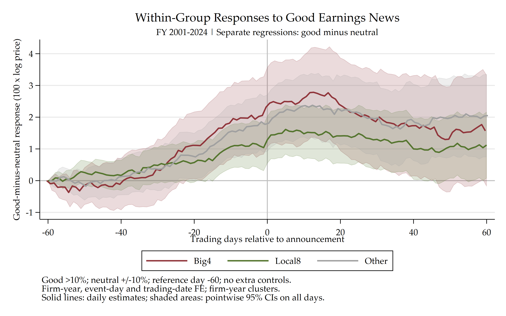

**二组：共同interaction回归的组间差**

Y为供应商含分红可比价格的log；样本为全样本的好消息与中性消息公告。$Y=FE+\sum_g\sum_{k\ne-60}\beta_{gk}A_gGood\,D_k+e$，共同受限回归；曲线为审计组间好消息响应系数之差，不另加审计组×事件日项。 公司×财年、事件日、实际日期FE，公司×财年聚类，无额外控制；系数以−60日为基期，纵轴为100倍系数。

|回归样本|公告|公司|有效日观察|每份公告日数范围|
|---|---:|---:|---:|---:|
|共同回归：二组|20,408|4,340|2,433,465|40—121|

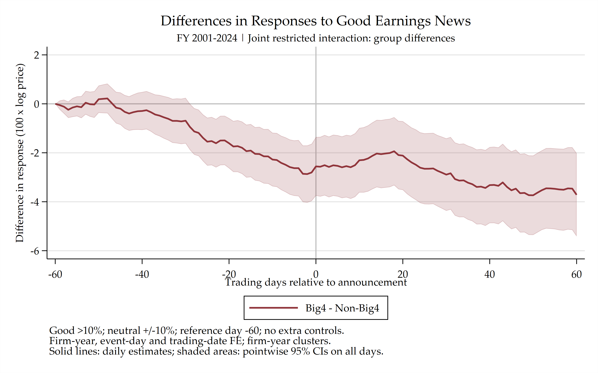

**三组：共同interaction回归的组间差**

Y为供应商含分红可比价格的log；样本为全样本的好消息与中性消息公告。$Y=FE+\sum_g\sum_{k\ne-60}\beta_{gk}A_gGood\,D_k+e$，共同受限回归；曲线为审计组间好消息响应系数之差，不另加审计组×事件日项。 公司×财年、事件日、实际日期FE，公司×财年聚类，无额外控制；系数以−60日为基期，纵轴为100倍系数。

|回归样本|公告|公司|有效日观察|每份公告日数范围|
|---|---:|---:|---:|---:|
|共同回归：三组|20,408|4,340|2,433,465|40—121|

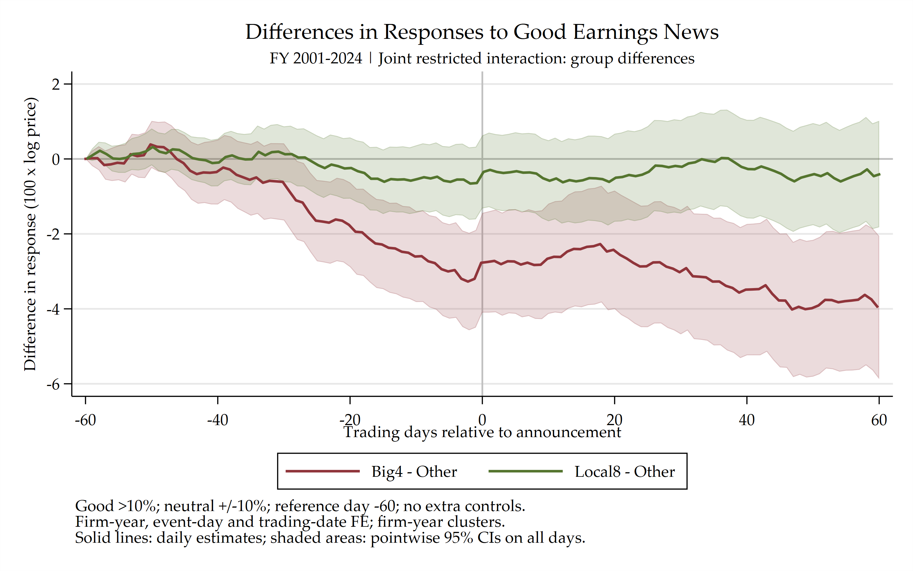

### 2012年前：含分红再投资价格log

**二组：分别组内回归**

Y为供应商含分红可比价格的log；样本为2012年前的好消息与中性消息公告。$Y=FE+\sum_{k\ne-60}\theta_{gk}Good\,D_k+e$，各审计组分别回归；曲线为各组好消息相对中性的响应。 公司×财年、事件日、实际日期FE，公司×财年聚类，无额外控制；系数以−60日为基期，纵轴为100倍系数。

|回归样本|公告|公司|有效日观察|每份公告日数范围|
|---|---:|---:|---:|---:|
|四大组内|552|158|65,230|78—121|
|非四大组内|4,031|1,616|475,097|56—121|

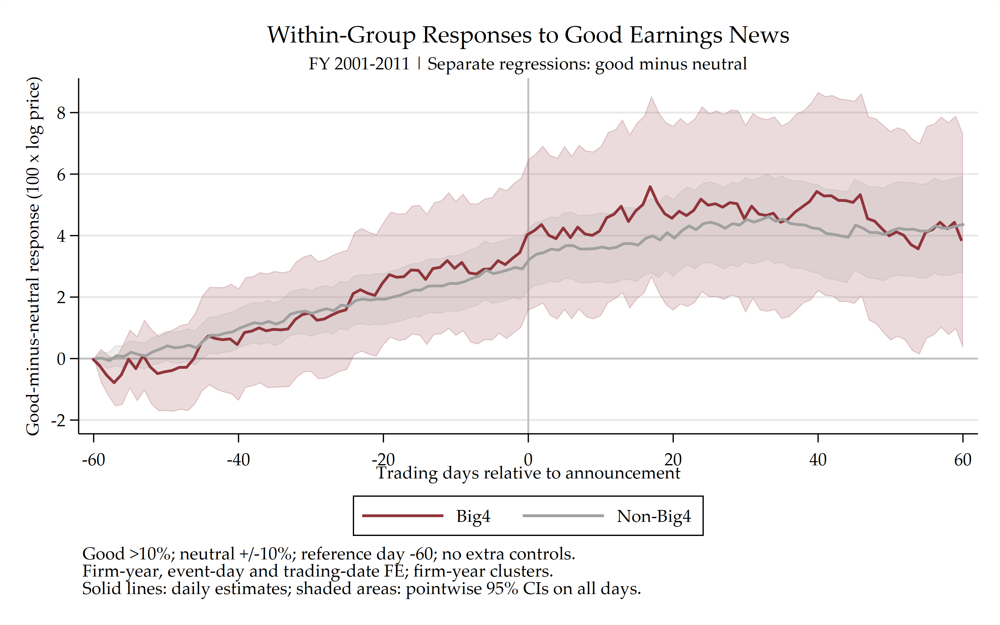

**三组：分别组内回归**

Y为供应商含分红可比价格的log；样本为2012年前的好消息与中性消息公告。$Y=FE+\sum_{k\ne-60}\theta_{gk}Good\,D_k+e$，各审计组分别回归；曲线为各组好消息相对中性的响应。 公司×财年、事件日、实际日期FE，公司×财年聚类，无额外控制；系数以−60日为基期，纵轴为100倍系数。

|回归样本|公告|公司|有效日观察|每份公告日数范围|
|---|---:|---:|---:|---:|
|四大组内|552|158|65,230|78—121|
|本土八大组内|1,775|813|209,725|61—121|
|Other组内|2,256|982|265,296|56—121|

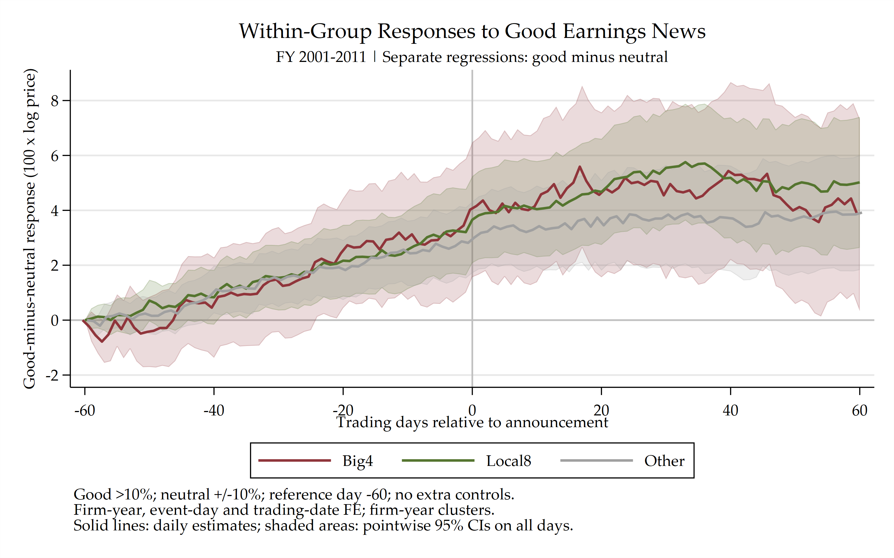

**二组：共同interaction回归的组间差**

Y为供应商含分红可比价格的log；样本为2012年前的好消息与中性消息公告。$Y=FE+\sum_g\sum_{k\ne-60}\beta_{gk}A_gGood\,D_k+e$，共同受限回归；曲线为审计组间好消息响应系数之差，不另加审计组×事件日项。 公司×财年、事件日、实际日期FE，公司×财年聚类，无额外控制；系数以−60日为基期，纵轴为100倍系数。

|回归样本|公告|公司|有效日观察|每份公告日数范围|
|---|---:|---:|---:|---:|
|共同回归：二组|4,583|1,719|540,416|56—121|

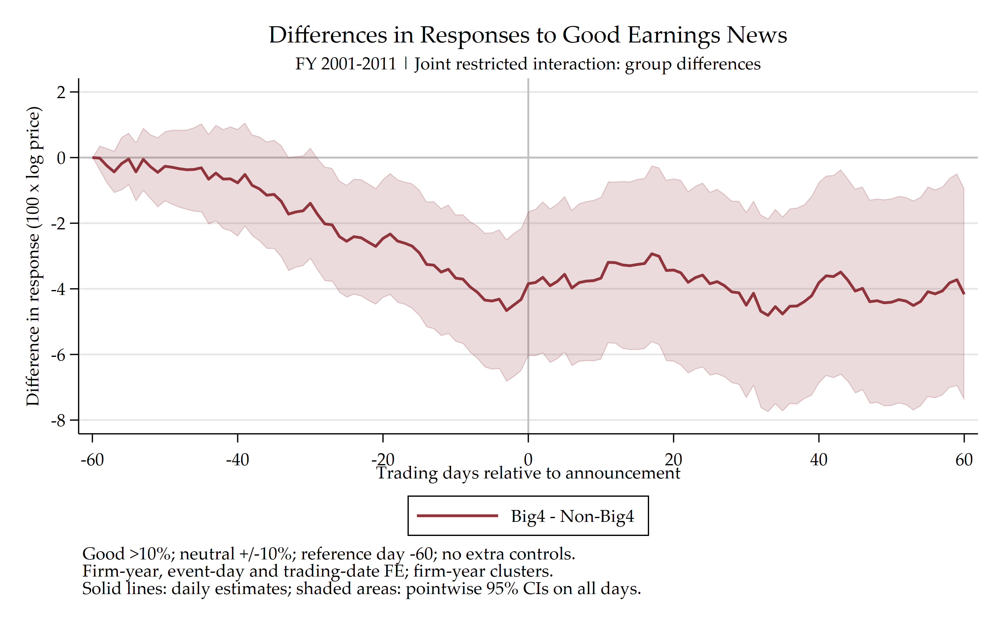

**三组：共同interaction回归的组间差**

Y为供应商含分红可比价格的log；样本为2012年前的好消息与中性消息公告。$Y=FE+\sum_g\sum_{k\ne-60}\beta_{gk}A_gGood\,D_k+e$，共同受限回归；曲线为审计组间好消息响应系数之差，不另加审计组×事件日项。 公司×财年、事件日、实际日期FE，公司×财年聚类，无额外控制；系数以−60日为基期，纵轴为100倍系数。

|回归样本|公告|公司|有效日观察|每份公告日数范围|
|---|---:|---:|---:|---:|
|共同回归：三组|4,583|1,719|540,416|56—121|

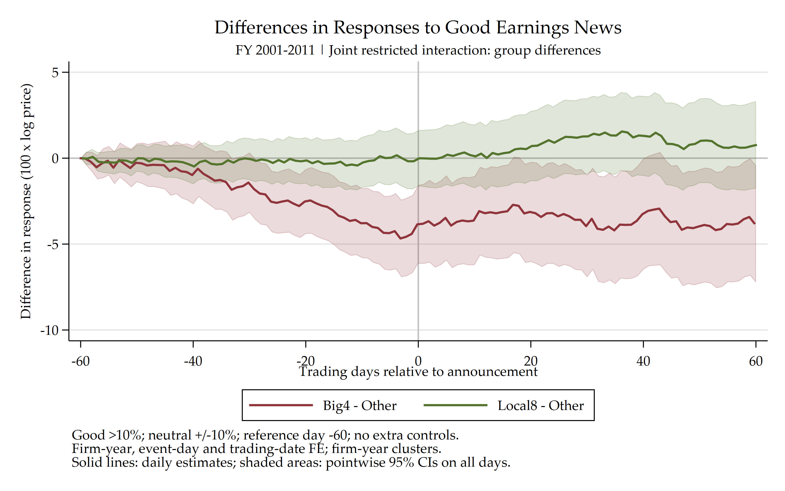

### 2012年起：含分红再投资价格log

**二组：分别组内回归**

Y为供应商含分红可比价格的log；样本为2012年起的好消息与中性消息公告。$Y=FE+\sum_{k\ne-60}\theta_{gk}Good\,D_k+e$，各审计组分别回归；曲线为各组好消息相对中性的响应。 公司×财年、事件日、实际日期FE，公司×财年聚类，无额外控制；系数以−60日为基期，纵轴为100倍系数。

|回归样本|公告|公司|有效日观察|每份公告日数范围|
|---|---:|---:|---:|---:|
|四大组内|2,028|422|244,141|62—121|
|非四大组内|13,797|3,830|1,648,850|40—121|

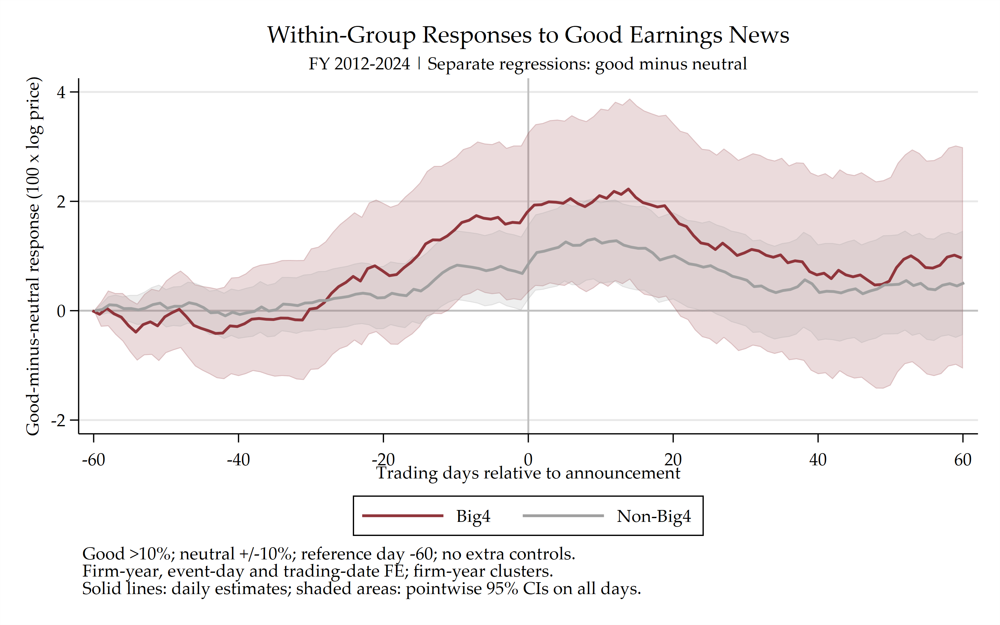

**三组：分别组内回归**

Y为供应商含分红可比价格的log；样本为2012年起的好消息与中性消息公告。$Y=FE+\sum_{k\ne-60}\theta_{gk}Good\,D_k+e$，各审计组分别回归；曲线为各组好消息相对中性的响应。 公司×财年、事件日、实际日期FE，公司×财年聚类，无额外控制；系数以−60日为基期，纵轴为100倍系数。

|回归样本|公告|公司|有效日观察|每份公告日数范围|
|---|---:|---:|---:|---:|
|四大组内|2,028|422|244,141|62—121|
|本土八大组内|9,298|2,778|1,110,771|40—121|
|Other组内|4,499|1,625|537,964|64—121|

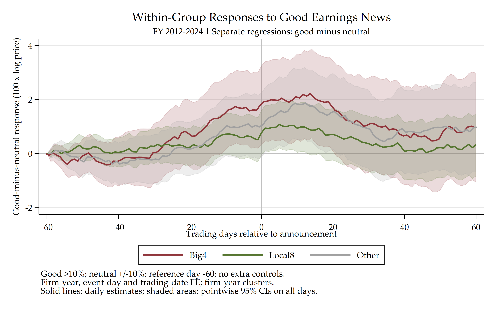

**二组：共同interaction回归的组间差**

Y为供应商含分红可比价格的log；样本为2012年起的好消息与中性消息公告。$Y=FE+\sum_g\sum_{k\ne-60}\beta_{gk}A_gGood\,D_k+e$，共同受限回归；曲线为审计组间好消息响应系数之差，不另加审计组×事件日项。 公司×财年、事件日、实际日期FE，公司×财年聚类，无额外控制；系数以−60日为基期，纵轴为100倍系数。

|回归样本|公告|公司|有效日观察|每份公告日数范围|
|---|---:|---:|---:|---:|
|共同回归：二组|15,825|4,105|1,893,049|40—121|

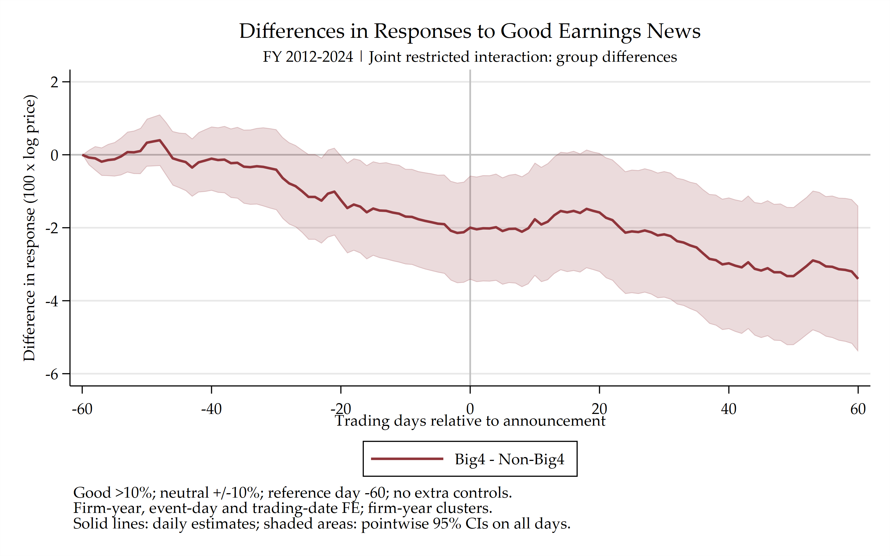

**三组：共同interaction回归的组间差**

Y为供应商含分红可比价格的log；样本为2012年起的好消息与中性消息公告。$Y=FE+\sum_g\sum_{k\ne-60}\beta_{gk}A_gGood\,D_k+e$，共同受限回归；曲线为审计组间好消息响应系数之差，不另加审计组×事件日项。 公司×财年、事件日、实际日期FE，公司×财年聚类，无额外控制；系数以−60日为基期，纵轴为100倍系数。

|回归样本|公告|公司|有效日观察|每份公告日数范围|
|---|---:|---:|---:|---:|
|共同回归：三组|15,825|4,105|1,893,049|40—121|

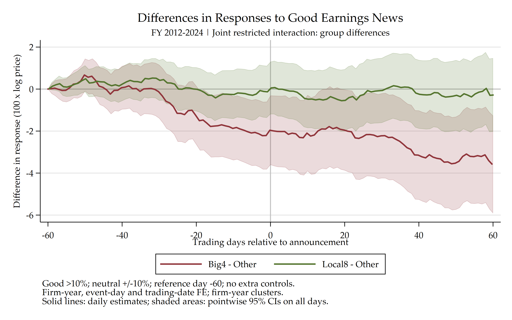

### 含分红再投资价格log：同模型区间变化

|时期|对象|区间|变化（100×系数）|p值|
|---|---|---|---:|---:|
|all|四大组内|pre_to_m1|2.055|0.0010|
|all|四大组内|m1_to_p5|0.441|0.0827|
|all|四大组内|m1_to_p60|-0.485|0.4682|
|all|四大组内|p5_to_p60|-0.926|0.1370|
|all|四大−非四大|pre_to_m1|-2.805|0.0000|
|all|四大−非四大|m1_to_p5|0.270|0.2515|
|all|四大−非四大|m1_to_p60|-0.912|0.1448|
|all|四大−非四大|p5_to_p60|-1.182|0.0415|
|before2012|四大组内|pre_to_m1|3.446|0.0057|
|before2012|四大组内|m1_to_p5|0.802|0.0935|
|before2012|四大组内|m1_to_p60|0.383|0.7709|
|before2012|四大组内|p5_to_p60|-0.419|0.7397|
|before2012|四大−非四大|pre_to_m1|-4.327|0.0001|
|before2012|四大−非四大|m1_to_p5|0.770|0.0628|
|before2012|四大−非四大|m1_to_p60|0.161|0.8944|
|before2012|四大−非四大|p5_to_p60|-0.609|0.5969|
|after2012|四大组内|pre_to_m1|1.605|0.0262|
|after2012|四大组内|m1_to_p5|0.359|0.2288|
|after2012|四大组内|m1_to_p60|-0.642|0.4039|
|after2012|四大组内|p5_to_p60|-1.001|0.1583|
|after2012|四大−非四大|pre_to_m1|-2.123|0.0026|
|after2012|四大−非四大|m1_to_p5|0.033|0.9070|
|after2012|四大−非四大|m1_to_p60|-1.278|0.0807|
|after2012|四大−非四大|p5_to_p60|-1.311|0.0515|
## 市场调整CAR：关键系数与事前检验

|时期|估计对象|−1日：系数（p）|+5日：系数（p）|+60日：系数（p）|事前联合p|
|---|---|---:|---:|---:|---:|
|all|四大组内|2.395（0.0003）|2.846（0.0001）|2.081（0.0258）|0.6083|
|all|非四大组内|0.990（0.0014）|1.489（0.0000）|0.938（0.0350）|0.0334|
|all|本土八大组内|0.673（0.0934）|1.206（0.0047）|0.442（0.4385）|0.1354|
|all|Other组内|1.514（0.0017）|1.963（0.0002）|1.818（0.0102）|0.0871|
|all|四大−非四大|-3.079（0.0000）|-2.890（0.0000）|-4.564（0.0000）|0.0007|
|all|四大−Other|-3.457（0.0000）|-3.081（0.0001）|-4.981（0.0000）|0.0023|
|all|本土八大−Other|-0.616（0.2364）|-0.310（0.5790）|-0.678（0.3761）|0.1309|
|before2012|四大组内|4.400（0.0014）|5.210（0.0005）|4.841（0.0094）|0.0910|
|before2012|非四大组内|2.577（0.0000）|3.317（0.0000）|4.139（0.0000）|0.0034|
|before2012|本土八大组内|2.520（0.0027）|3.475（0.0001）|4.129（0.0011）|0.1241|
|before2012|Other组内|2.762（0.0001）|3.334（0.0000）|4.230（0.0001）|0.0062|
|before2012|四大−非四大|-4.006（0.0023）|-3.321（0.0184）|-4.573（0.0106）|0.0000|
|before2012|四大−Other|-4.231（0.0019）|-3.375（0.0206）|-4.533（0.0160）|0.0012|
|before2012|本土八大−Other|-0.510（0.5523）|-0.116（0.9011）|0.097（0.9419）|0.5744|
|after2012|四大组内|1.759（0.0184）|2.127（0.0074）|1.309（0.2223）|0.6085|
|after2012|非四大组内|0.371（0.3122）|0.909（0.0201）|-0.094（0.8561）|0.1175|
|after2012|本土八大组内|0.208（0.6450）|0.723（0.1323）|-0.324（0.6107）|0.0893|
|after2012|Other组内|0.670（0.2842）|1.250（0.0625）|0.460（0.6097）|0.6592|
|after2012|四大−非四大|-2.601（0.0006）|-2.645（0.0010）|-4.363（0.0000）|0.0316|
|after2012|四大−Other|-2.617（0.0028）|-2.648（0.0046）|-4.599（0.0002）|0.1102|
|after2012|本土八大−Other|-0.025（0.9705）|-0.005（0.9939）|-0.342（0.7206）|0.3062|

### 全样本：市场调整CAR

**二组：分别组内回归**

Y为含分红日收益减全市场日收益的累计CAR；样本为全样本的好消息与中性消息公告。$Y=FE+\sum_{k\ne-60}\theta_{gk}Good\,D_k+e$，各审计组分别回归；曲线为各组好消息相对中性的响应。 公司×财年、事件日、实际日期FE，公司×财年聚类，无额外控制；系数以−60日为基期，纵轴为100倍系数。

|回归样本|公告|公司|有效日观察|每份公告日数范围|
|---|---:|---:|---:|---:|
|四大组内|2,580|456|312,048|104—121|
|非四大组内|17,828|4,094|2,157,125|111—121|

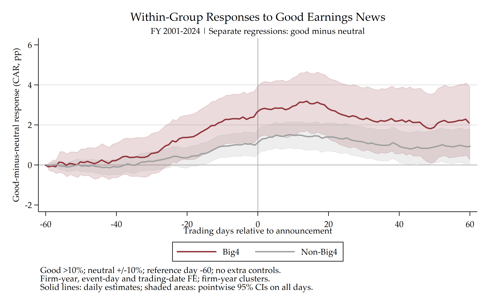

**三组：分别组内回归**

Y为含分红日收益减全市场日收益的累计CAR；样本为全样本的好消息与中性消息公告。$Y=FE+\sum_{k\ne-60}\theta_{gk}Good\,D_k+e$，各审计组分别回归；曲线为各组好消息相对中性的响应。 公司×财年、事件日、实际日期FE，公司×财年聚类，无额外控制；系数以−60日为基期，纵轴为100倍系数。

|回归样本|公告|公司|有效日观察|每份公告日数范围|
|---|---:|---:|---:|---:|
|四大组内|2,580|456|312,048|104—121|
|本土八大组内|11,073|2,927|1,339,707|104—121|
|Other组内|6,755|2,057|817,224|104—121|

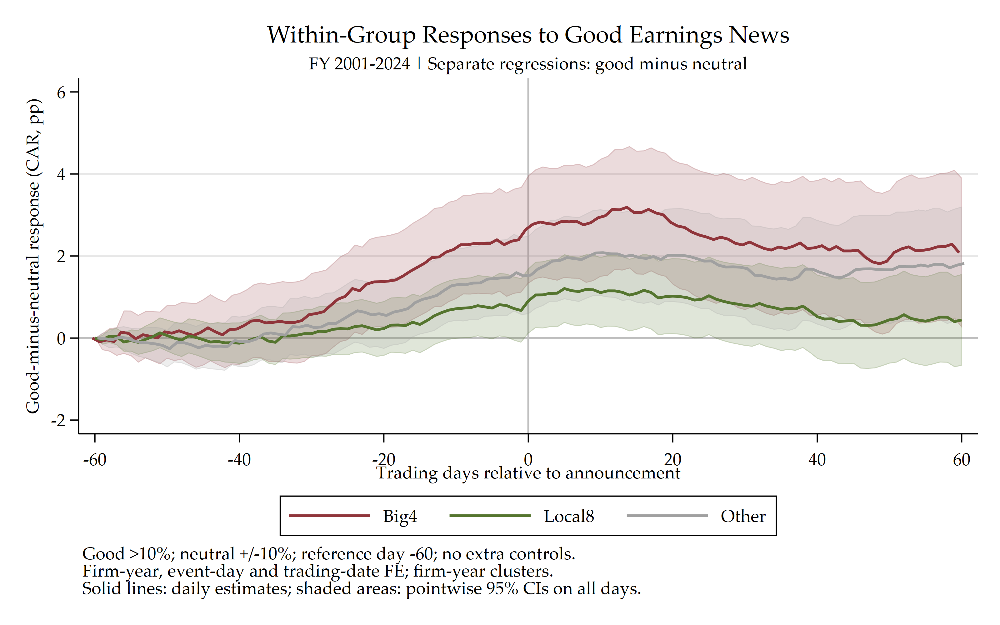

**二组：共同interaction回归的组间差**

Y为含分红日收益减全市场日收益的累计CAR；样本为全样本的好消息与中性消息公告。$Y=FE+\sum_g\sum_{k\ne-60}\beta_{gk}A_gGood\,D_k+e$，共同受限回归；曲线为审计组间好消息响应系数之差，不另加审计组×事件日项。 公司×财年、事件日、实际日期FE，公司×财年聚类，无额外控制；系数以−60日为基期，纵轴为100倍系数。

|回归样本|公告|公司|有效日观察|每份公告日数范围|
|---|---:|---:|---:|---:|
|共同回归：二组|20,408|4,340|2,469,320|114—121|

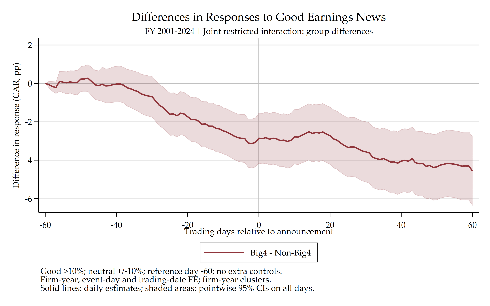

**三组：共同interaction回归的组间差**

Y为含分红日收益减全市场日收益的累计CAR；样本为全样本的好消息与中性消息公告。$Y=FE+\sum_g\sum_{k\ne-60}\beta_{gk}A_gGood\,D_k+e$，共同受限回归；曲线为审计组间好消息响应系数之差，不另加审计组×事件日项。 公司×财年、事件日、实际日期FE，公司×财年聚类，无额外控制；系数以−60日为基期，纵轴为100倍系数。

|回归样本|公告|公司|有效日观察|每份公告日数范围|
|---|---:|---:|---:|---:|
|共同回归：三组|20,408|4,340|2,469,320|114—121|

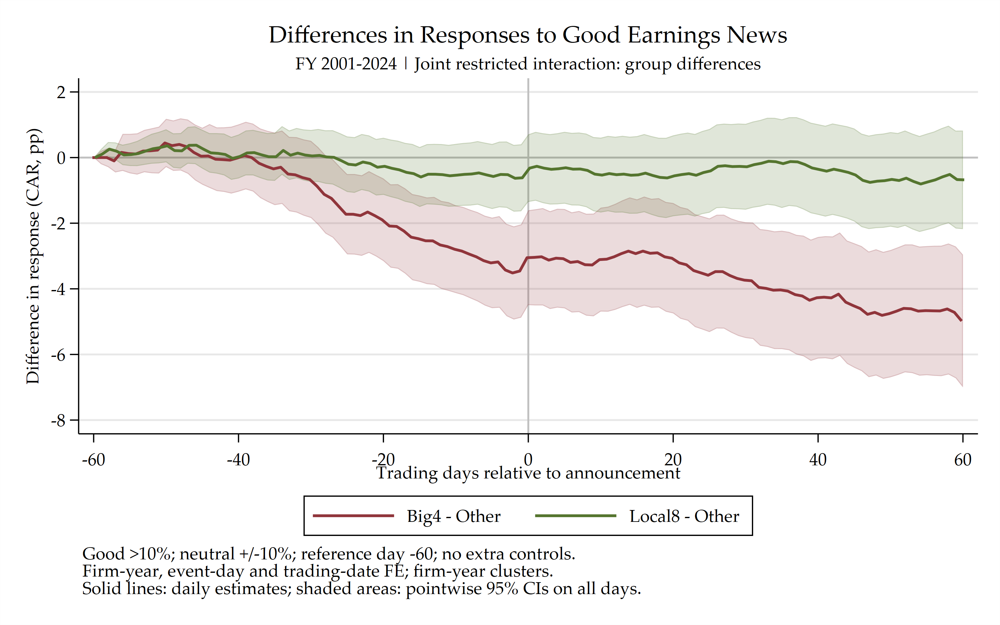

### 2012年前：市场调整CAR

**二组：分别组内回归**

Y为含分红日收益减全市场日收益的累计CAR；样本为2012年前的好消息与中性消息公告。$Y=FE+\sum_{k\ne-60}\theta_{gk}Good\,D_k+e$，各审计组分别回归；曲线为各组好消息相对中性的响应。 公司×财年、事件日、实际日期FE，公司×财年聚类，无额外控制；系数以−60日为基期，纵轴为100倍系数。

|回归样本|公告|公司|有效日观察|每份公告日数范围|
|---|---:|---:|---:|---:|
|四大组内|552|158|66,719|104—121|
|非四大组内|4,031|1,616|487,718|111—121|

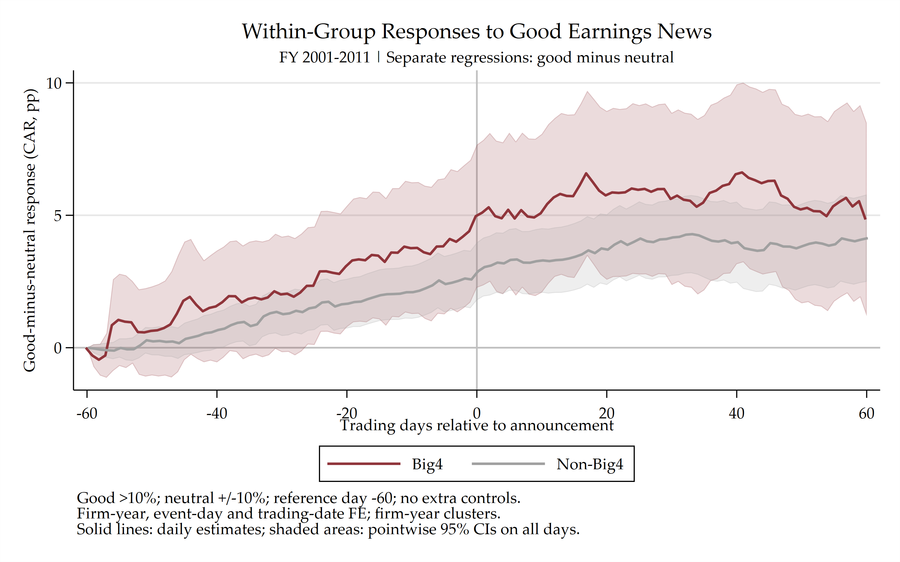

**三组：分别组内回归**

Y为含分红日收益减全市场日收益的累计CAR；样本为2012年前的好消息与中性消息公告。$Y=FE+\sum_{k\ne-60}\theta_{gk}Good\,D_k+e$，各审计组分别回归；曲线为各组好消息相对中性的响应。 公司×财年、事件日、实际日期FE，公司×财年聚类，无额外控制；系数以−60日为基期，纵轴为100倍系数。

|回归样本|公告|公司|有效日观察|每份公告日数范围|
|---|---:|---:|---:|---:|
|四大组内|552|158|66,719|104—121|
|本土八大组内|1,775|813|214,703|104—121|
|Other组内|2,256|982|272,936|104—121|

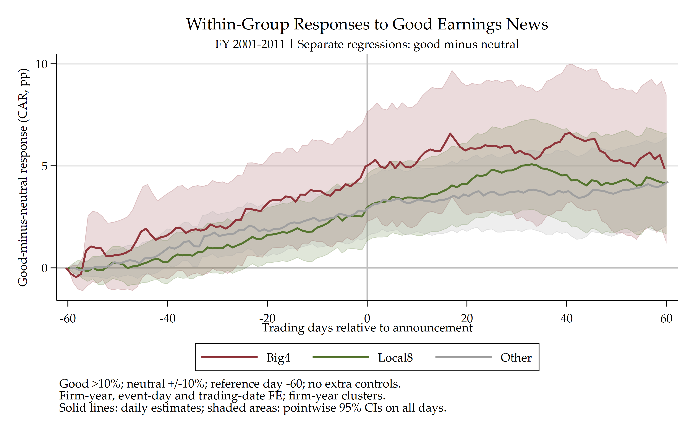

**二组：共同interaction回归的组间差**

Y为含分红日收益减全市场日收益的累计CAR；样本为2012年前的好消息与中性消息公告。$Y=FE+\sum_g\sum_{k\ne-60}\beta_{gk}A_gGood\,D_k+e$，共同受限回归；曲线为审计组间好消息响应系数之差，不另加审计组×事件日项。 公司×财年、事件日、实际日期FE，公司×财年聚类，无额外控制；系数以−60日为基期，纵轴为100倍系数。

|回归样本|公告|公司|有效日观察|每份公告日数范围|
|---|---:|---:|---:|---:|
|共同回归：二组|4,583|1,719|554,521|117—121|

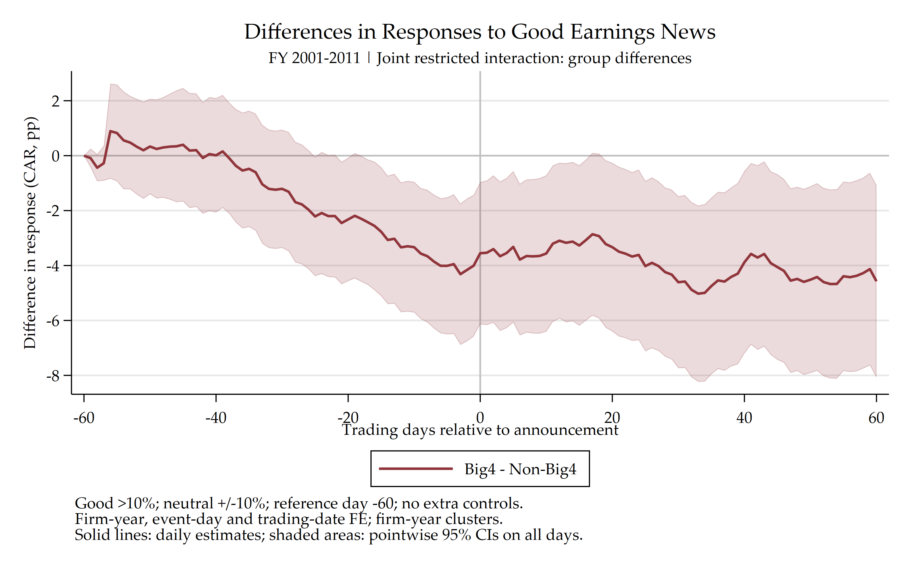

**三组：共同interaction回归的组间差**

Y为含分红日收益减全市场日收益的累计CAR；样本为2012年前的好消息与中性消息公告。$Y=FE+\sum_g\sum_{k\ne-60}\beta_{gk}A_gGood\,D_k+e$，共同受限回归；曲线为审计组间好消息响应系数之差，不另加审计组×事件日项。 公司×财年、事件日、实际日期FE，公司×财年聚类，无额外控制；系数以−60日为基期，纵轴为100倍系数。

|回归样本|公告|公司|有效日观察|每份公告日数范围|
|---|---:|---:|---:|---:|
|共同回归：三组|4,583|1,719|554,521|117—121|

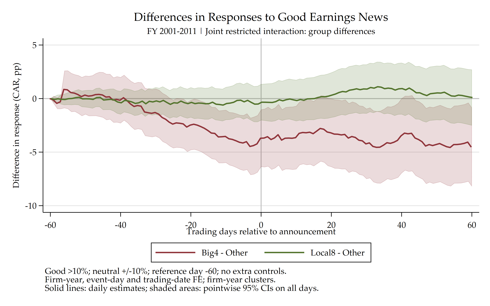

### 2012年起：市场调整CAR

**二组：分别组内回归**

Y为含分红日收益减全市场日收益的累计CAR；样本为2012年起的好消息与中性消息公告。$Y=FE+\sum_{k\ne-60}\theta_{gk}Good\,D_k+e$，各审计组分别回归；曲线为各组好消息相对中性的响应。 公司×财年、事件日、实际日期FE，公司×财年聚类，无额外控制；系数以−60日为基期，纵轴为100倍系数。

|回归样本|公告|公司|有效日观察|每份公告日数范围|
|---|---:|---:|---:|---:|
|四大组内|2,028|422|245,329|104—121|
|非四大组内|13,797|3,830|1,669,407|114—121|

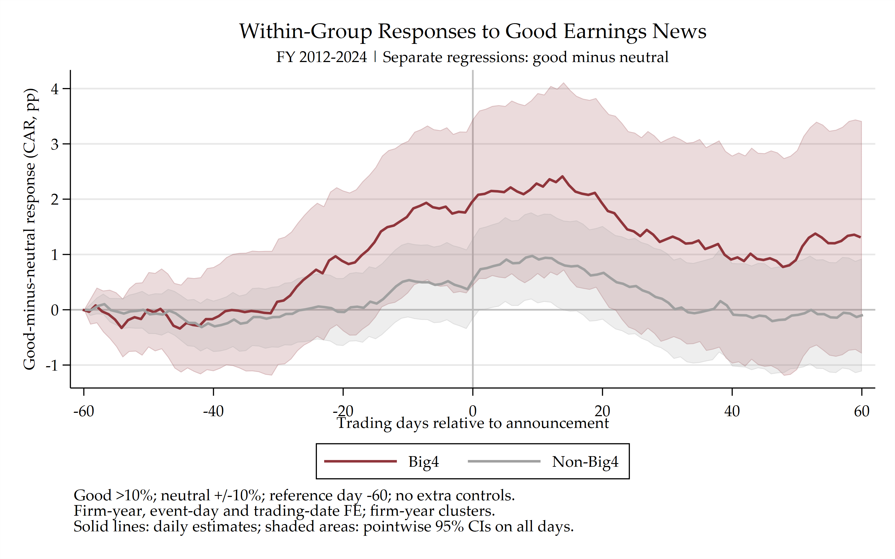

**三组：分别组内回归**

Y为含分红日收益减全市场日收益的累计CAR；样本为2012年起的好消息与中性消息公告。$Y=FE+\sum_{k\ne-60}\theta_{gk}Good\,D_k+e$，各审计组分别回归；曲线为各组好消息相对中性的响应。 公司×财年、事件日、实际日期FE，公司×财年聚类，无额外控制；系数以−60日为基期，纵轴为100倍系数。

|回归样本|公告|公司|有效日观察|每份公告日数范围|
|---|---:|---:|---:|---:|
|四大组内|2,028|422|245,329|104—121|
|本土八大组内|9,298|2,778|1,125,004|106—121|
|Other组内|4,499|1,625|544,288|108—121|

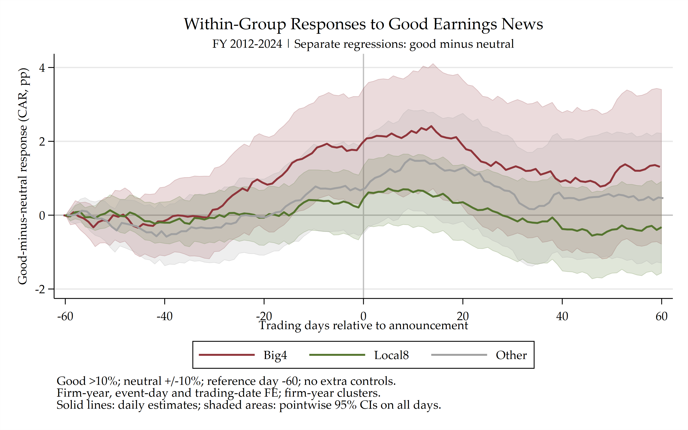

**二组：共同interaction回归的组间差**

Y为含分红日收益减全市场日收益的累计CAR；样本为2012年起的好消息与中性消息公告。$Y=FE+\sum_g\sum_{k\ne-60}\beta_{gk}A_gGood\,D_k+e$，共同受限回归；曲线为审计组间好消息响应系数之差，不另加审计组×事件日项。 公司×财年、事件日、实际日期FE，公司×财年聚类，无额外控制；系数以−60日为基期，纵轴为100倍系数。

|回归样本|公告|公司|有效日观察|每份公告日数范围|
|---|---:|---:|---:|---:|
|共同回归：二组|15,825|4,105|1,914,799|114—121|

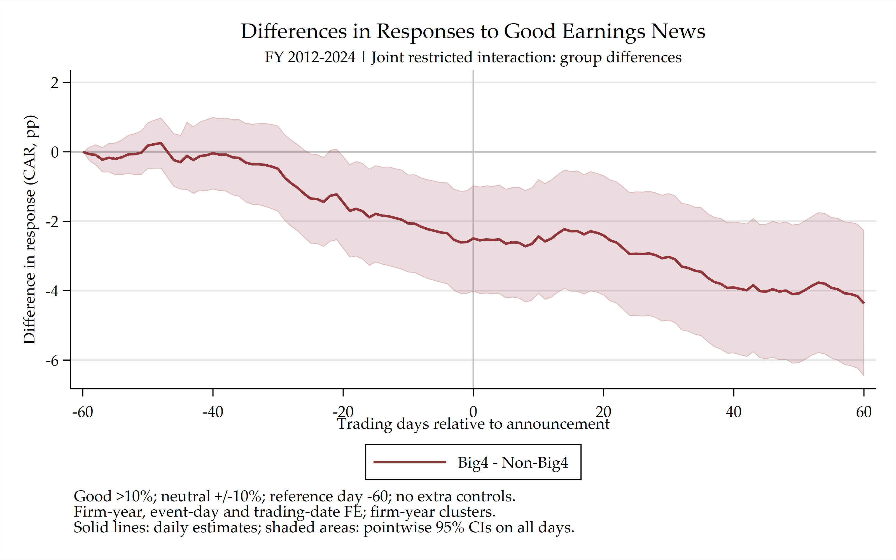

**三组：共同interaction回归的组间差**

Y为含分红日收益减全市场日收益的累计CAR；样本为2012年起的好消息与中性消息公告。$Y=FE+\sum_g\sum_{k\ne-60}\beta_{gk}A_gGood\,D_k+e$，共同受限回归；曲线为审计组间好消息响应系数之差，不另加审计组×事件日项。 公司×财年、事件日、实际日期FE，公司×财年聚类，无额外控制；系数以−60日为基期，纵轴为100倍系数。

|回归样本|公告|公司|有效日观察|每份公告日数范围|
|---|---:|---:|---:|---:|
|共同回归：三组|15,825|4,105|1,914,799|114—121|

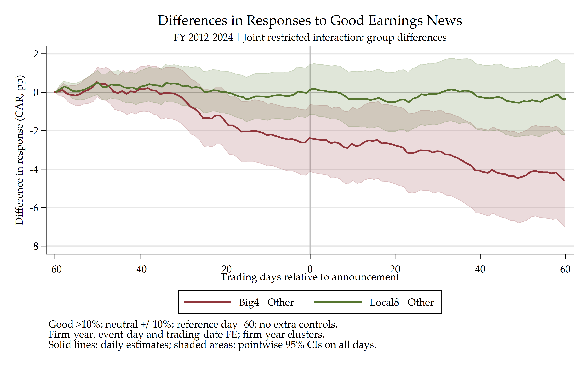

### 市场调整CAR：同模型区间变化

|时期|对象|区间|变化（100×系数）|p值|
|---|---|---|---:|---:|
|all|四大组内|pre_to_m1|2.395|0.0003|
|all|四大组内|m1_to_p5|0.450|0.0795|
|all|四大组内|m1_to_p60|-0.314|0.6465|
|all|四大组内|p5_to_p60|-0.764|0.2298|
|all|四大−非四大|pre_to_m1|-3.079|0.0000|
|all|四大−非四大|m1_to_p5|0.189|0.4272|
|all|四大−非四大|m1_to_p60|-1.485|0.0203|
|all|四大−非四大|p5_to_p60|-1.674|0.0048|
|before2012|四大组内|pre_to_m1|4.400|0.0014|
|before2012|四大组内|m1_to_p5|0.810|0.0937|
|before2012|四大组内|m1_to_p60|0.441|0.7357|
|before2012|四大组内|p5_to_p60|-0.369|0.7675|
|before2012|四大−非四大|pre_to_m1|-4.006|0.0023|
|before2012|四大−非四大|m1_to_p5|0.686|0.1007|
|before2012|四大−非四大|m1_to_p60|-0.567|0.6359|
|before2012|四大−非四大|p5_to_p60|-1.253|0.2727|
|after2012|四大组内|pre_to_m1|1.759|0.0184|
|after2012|四大组内|m1_to_p5|0.369|0.2217|
|after2012|四大组内|m1_to_p60|-0.449|0.5709|
|after2012|四大组内|p5_to_p60|-0.818|0.2637|
|after2012|四大−非四大|pre_to_m1|-2.601|0.0006|
|after2012|四大−非四大|m1_to_p5|-0.044|0.8770|
|after2012|四大−非四大|m1_to_p60|-1.763|0.0197|
|after2012|四大−非四大|p5_to_p60|-1.718|0.0135|

## 执行与样本核对

- 估计代码：。
- 绘图和区间检验：。
- 36个回归返回码均为0；各模型估计公告身份与相应队列逐项核对，未丢整份公告。原生reghdfe按既有规则剔除部分单例日观察，未改变队列。
- 新计算路径使用原生reghdfe分列残差化和既有Stata/Mata分块OLS，保持同一方程、FE和聚类修正。组内及共同模型与原生模型的系数、协方差和样本对照见column_validation.csv及column_binary_validation.csv。
- 为避免内存不足，每个残差块结束后释放HDFE对象，OLS与聚类得分按行块读取磁盘缓存。旧缓存接续先核对样本或完整首块残差；接续流程与原模型的独立对照见resume_validation.csv。
- 校验每个非基期系数的标准误、t分布p值和95%区间，核对覆盖计数、公司数、公告数及59项事前约束。
- sample_validation.csv为模型样本量；各模型estimation_events.csv为实际公告身份；pretests.csv为事前联合检验；interval_changes.csv为完整协方差下的区间检验。
